# Práctica 1 – Despliegue de Aplicaciones Web

## 1. Objetivo

Desarrollar y desplegar una API REST para gestionar eventos, recintos y entradas, utilizando Node.js, Express, Mongoose y MongoDB Atlas.

## 2. Tecnologías utilizadas

- Debian 12
- Node.js 24.22.2
- npm 11.19.1
- Express
- Mongoose
- MongoDB Atlas
- Nodemon
- Visual Studio Code
- Git y GitHub
- Render (despliegue)

## 3. Preparación del entorno

Se comprueba la instalación de las herramientas necesarias:

| Herramienta | Versión |
|---|---|
| Node.js | 24.22.2 |
| npm | 11.19.1 |
| Git | 2.39.5 |
| Visual Studio Code | 1.145.0 |

## 4. Estructura del proyecto

```text
Practica 1/
├── models/
│   ├── evento.js
│   └── recinto.js
├── routes/
│   ├── eventos.js
│   └── recintos.js
├── index.js
├── .env
├── .gitignore
├── package.json
└── package-lock.json
```

## 5. Dependencias

Se inicializa el proyecto Node.js y se instalan las dependencias:

- express: gestión del servidor y rutas REST.
- mongoose: conexión y gestión de modelos MongoDB.
- dotenv: lectura de variables de entorno.
- nodemon: reinicio automático del servidor durante el desarrollo.

## 6. Base de datos MongoDB Atlas

Se crea un clúster gratuito en MongoDB Atlas.

- Clúster: Cluster0
- Región: AWS, París (eu-west-3).
- Base de datos: eventos.

La conexión se configura mediante la variable MONGODB_URI en el fichero .env.

Las credenciales no se incluyen en el repositorio.

## 7. Implementación

Se crean los siguientes componentes:

- Modelo de eventos y subdocumentos de entradas.
- Modelo de recintos.
- Enrutador de eventos y entradas.
- Enrutador de recintos.
- Servidor principal Express.

## 8. Configuración del servidor

El servidor utiliza el puerto 3000 durante el desarrollo.

Se configura la conexión con MongoDB Atlas y el middleware para procesar peticiones JSON.

## 9. Comprobación inicial

Se ejecuta el servidor mediante:

```bash
npm run dev
```

Resultado obtenido:

- Conexión con MongoDB establecida correctamente.
- Servidor escuchando en el puerto 3000.

## 10. Pruebas y despliegue


### Prueba 1. GET /recintos — Colección vacía

**Objetivo:** comprobar la respuesta de la API cuando no existen recintos registrados.

**1. Arranque del servidor**

Se inicia la aplicación mediante:

```bash
npm run dev
```

Se comprueba que el servidor Express escucha en el puerto 3000 y que la conexión con MongoDB Atlas se establece correctamente.


**2. Petición HTTP**

```bash
curl -i http://localhost:3000/recintos
```

**3. Respuesta obtenida**

- Código HTTP: `500 Internal Server Error`.

```json
{
  "ok": false,
  "error": "No se han encontrado recintos"
}
```

**Evidencia de la ejecución:**


**4. Resultado**

**Prueba superada.** La API responde correctamente cuando la colección de recintos está vacía, devolviendo el código HTTP y el mensaje de error establecidos en el enunciado.


### Prueba 2. POST /recintos — Creación de recinto

**Objetivo:** comprobar la creación de un recinto en MongoDB Atlas.

**Petición:**

```bash
curl -i -X POST http://localhost:3000/recintos \
  -H "Content-Type: application/json" \
  -d '{
    "nombre": "Palacio de Congresos",
    "direccion": "Avenida de la Constitución 20",
    "localidad": "Sevilla",
    "aforoMaximo": 1500
  }'
```

**Resultado obtenido:**

- HTTP 201 Created.
- `ok: true`.
- Recinto creado correctamente con identificador `_id` generado por MongoDB.

**Conclusión:** prueba superada. El endpoint permite registrar recintos y devuelve la respuesta exigida.


### Prueba 3. GET /recintos — Consulta de recintos existentes

**Objetivo:** comprobar que la API recupera correctamente los recintos almacenados en MongoDB Atlas.

**Petición:**

```bash
curl -i http://localhost:3000/recintos
```

**Respuesta obtenida:**

- Código HTTP: `200 OK`.
- `ok: true`.
- `resultado`: array con el recinto registrado.

```json
{
  "ok": true,
  "resultado": [
    {
      "_id": "6aff5e1da0b04067fccec036",
      "nombre": "Palacio de Congresos",
      "direccion": "Avenida de la Constitución 20",
      "localidad": "Sevilla",
      "aforoMaximo": 1500,
      "__v": 0
    }
  ]
}
```

**Evidencia de la ejecución:**


**Resultado:** prueba superada. La API recupera los recintos registrados y devuelve el código HTTP y la estructura JSON establecidos en el enunciado.


### Prueba 4. GET /recintos/:id — Consulta por identificador

**Objetivo:** comprobar que la API recupera un recinto concreto mediante su identificador de MongoDB.

**Petición:**

```bash
curl -i http://localhost:3000/recintos/6aff5e1da0b04067fccec036
```

**Respuesta obtenida:**

- Código HTTP: `200 OK`.
- `ok: true`.
- `resultado`: objeto con los datos del recinto solicitado.

```json
{
  "ok": true,
  "resultado": {
    "_id": "6aff5e1da0b04067fccec036",
    "nombre": "Palacio de Congresos",
    "direccion": "Avenida de la Constitución 20",
    "localidad": "Sevilla",
    "aforoMaximo": 1500,
    "__v": 0
  }
}
```

**Evidencia de la ejecución:**

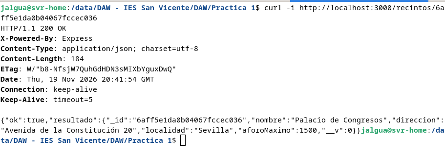

**Resultado:** prueba superada. La API localiza el recinto mediante su identificador y devuelve la respuesta HTTP y JSON esperada.


### Prueba 5. GET /recintos/localidad/:nombre — Consulta por localidad

**Objetivo:** comprobar que la API recupera los recintos registrados en una localidad determinada.

**Petición:**

```bash
curl -i http://localhost:3000/recintos/localidad/Sevilla
```

**Respuesta obtenida:**

- Código HTTP: `200 OK`.
- `ok: true`.
- `resultado`: array con los recintos de Sevilla.

```json
{
  "ok": true,
  "resultado": [
    {
      "_id": "6aff5e1da0b04067fccec036",
      "nombre": "Palacio de Congresos",
      "direccion": "Avenida de la Constitución 20",
      "localidad": "Sevilla",
      "aforoMaximo": 1500,
      "__v": 0
    }
  ]
}
```

**Evidencia de la ejecución:**

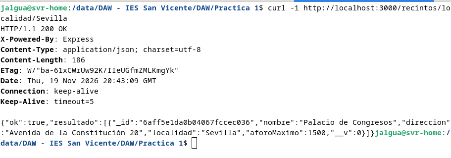

**Resultado:** prueba superada. La API filtra correctamente los recintos por localidad y devuelve la respuesta exigida en el enunciado.


### Prueba 6. GET /recintos/:id — Recinto inexistente

**Objetivo:** comprobar que la API devuelve el error correspondiente cuando se consulta un recinto que no existe en MongoDB Atlas.

**Petición:**

```bash
curl -i http://localhost:3000/recintos/000000000000000000000000
```

**Respuesta obtenida:**

- Código HTTP: `404 Not Found`.
- `ok: false`.

```json
{
  "ok": false,
  "error": "Recinto 000000000000000000000000 no encontrado"
}
```

**Evidencia de la ejecución:**

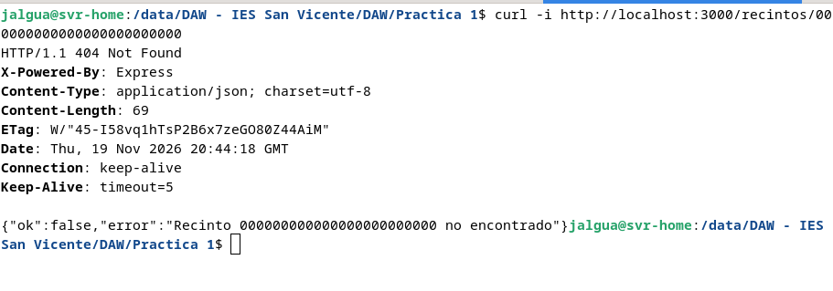

**Resultado:** prueba superada. La API identifica que el recinto solicitado no existe y devuelve el código HTTP 404 y el mensaje de error establecidos en el enunciado.


### Prueba 7. GET /recintos/localidad/:nombre — Localidad sin recintos

**Objetivo:** comprobar que la API devuelve el error correspondiente cuando no existen recintos registrados en la localidad solicitada.

**Petición:**

```bash
curl -i http://localhost:3000/recintos/localidad/Valencia
```

**Respuesta obtenida:**

- Código HTTP: `404 Not Found`.
- `ok: false`.

```json
{
  "ok": false,
  "error": "No se han encontrado recintos de la localidad indicada"
}
```

**Evidencia de la ejecución:**

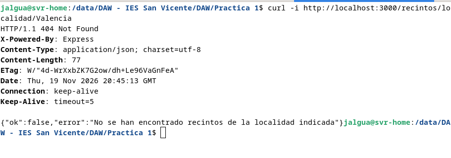

**Resultado:** prueba superada. La API devuelve el código HTTP 404 y el mensaje de error establecidos en el enunciado cuando no existen recintos en la localidad consultada.


### Prueba 8. POST /recintos — Validación de datos incorrectos

**Objetivo:** comprobar que la API rechaza la creación de recintos cuyos campos no cumplen las longitudes mínimas establecidas en el modelo Mongoose.

**Petición:**

```bash
curl -i -X POST http://localhost:3000/recintos \
  -H "Content-Type: application/json" \
  -d '{
    "nombre": "ABC",
    "direccion": "Calle 1",
    "localidad": "Se"
  }'
```

**Datos incorrectos:**

- `nombre`: 3 caracteres, mínimo 5.
- `direccion`: 7 caracteres, mínimo 10.
- `localidad`: 2 caracteres, mínimo 3.

**Respuesta obtenida:**

- Código HTTP: `500 Internal Server Error`.
- `ok: false`.

```json
{
  "ok": false,
  "error": "Error añadiendo recinto"
}
```

**Evidencia de la ejecución:**

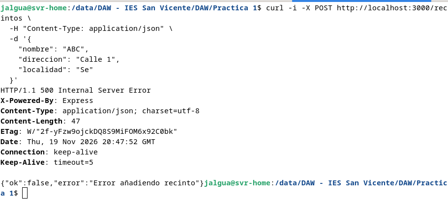

**Resultado:** prueba superada. Mongoose rechaza los datos que incumplen las validaciones y la API devuelve el código HTTP y el mensaje de error previstos.


### Prueba 9. DELETE /recintos/:id — Eliminación de recinto inexistente

**Objetivo:** comprobar que la API devuelve el error correspondiente cuando se intenta eliminar un recinto que no existe en MongoDB Atlas.

**Petición:**

```bash
curl -i -X DELETE http://localhost:3000/recintos/000000000000000000000000
```

**Respuesta obtenida:**

- Código HTTP: `404 Not Found`.
- `ok: false`.

```json
{
  "ok": false,
  "error": "Error eliminando recinto 000000000000000000000000"
}
```

**Evidencia de la ejecución:**

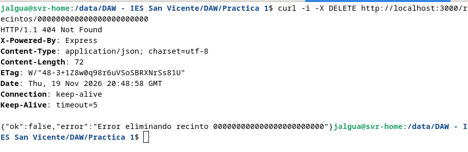

**Resultado:** prueba superada. La API devuelve el código HTTP 404 y el mensaje de error establecidos en el enunciado. El recinto existente se conserva para las pruebas posteriores.


### Prueba 10. DELETE /recintos/:id — Eliminación de recinto existente

**Objetivo:** comprobar que la API permite eliminar un recinto existente en MongoDB Atlas.

**1. Creación de un recinto temporal**

Para conservar el recinto principal que utilizaremos en las pruebas de eventos, se crea un recinto específico para comprobar su eliminación.

**Petición:**

```bash
curl -i -X POST http://localhost:3000/recintos \
  -H "Content-Type: application/json" \
  -d '{
    "nombre": "Recinto de Pruebas",
    "direccion": "Avenida de las Ciencias 15",
    "localidad": "Sevilla",
    "aforoMaximo": 500
  }'
```

**Respuesta:** HTTP `201 Created`, con `ok: true` y el identificador generado por MongoDB.

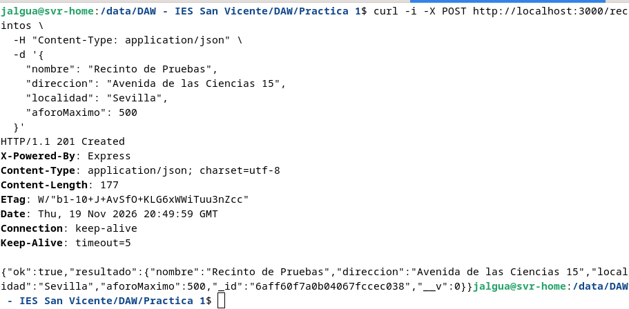

**2. Eliminación del recinto**

**Petición:**

```bash
curl -i -X DELETE http://localhost:3000/recintos/6aff60f7a0b04067fccec038
```

**Respuesta obtenida:**

- Código HTTP: `200 OK`.
- `ok: true`.

```json
{
  "ok": true,
  "resultado": {
    "_id": "6aff60f7a0b04067fccec038",
    "nombre": "Recinto de Pruebas",
    "direccion": "Avenida de las Ciencias 15",
    "localidad": "Sevilla",
    "aforoMaximo": 500,
    "__v": 0
  }
}
```

**Evidencia de la ejecución:**

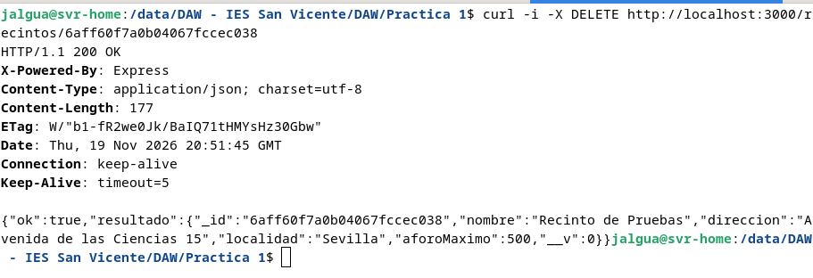

**Resultado:** prueba superada. La API elimina correctamente el recinto y devuelve los datos del documento eliminado, con la respuesta HTTP y JSON esperada.


### Prueba 11. GET /eventos — Colección vacía

**Objetivo:** comprobar que la API devuelve la respuesta prevista cuando no existen eventos registrados en MongoDB Atlas.

**Petición:**

```bash
curl -i http://localhost:3000/eventos
```

**Respuesta obtenida:**

- Código HTTP: `500 Internal Server Error`.
- `ok: false`.

```json
{
  "ok": false,
  "error": "No se han encontrado eventos"
}
```

**Evidencia de la ejecución:**

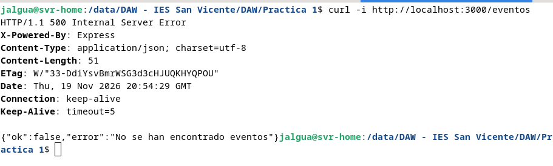

**Resultado:** prueba superada. La API devuelve el código HTTP 500 y el mensaje de error establecidos en el enunciado cuando no existen eventos registrados.


### Prueba 12. POST /eventos — Creación de evento

**Objetivo:** comprobar que la API permite crear un evento asociado a un recinto existente, incluyendo diferentes tipos de entradas.

**Petición:**

```bash
curl -i -X POST http://localhost:3000/eventos \
  -H "Content-Type: application/json" \
  -d '{
    "nombre": "Concierto de Navidad",
    "fecha": "2026-12-20T20:00:00.000Z",
    "entradas": [
      {
        "tipo": "General",
        "precio": 35,
        "disponibles": 500
      },
      {
        "tipo": "VIP",
        "precio": 80,
        "disponibles": 100
      }
    ],
    "recinto": "6aff5e1da0b04067fccec036"
  }'
```

**Respuesta obtenida:**

- Código HTTP: `201 Created`.
- `ok: true`.
- `resultado`: objeto con el evento creado.
- Identificador generado: `6aff623ba0b04067fccec039`.

**Datos registrados:**

| Campo | Valor |
|---|---|
| Nombre | Concierto de Navidad |
| Fecha | 20/12/2026, 20:00 UTC |
| Recinto | Palacio de Congresos |
| Entrada General | 35 € — 500 disponibles |
| Entrada VIP | 80 € — 100 disponibles |

**Evidencia de la ejecución:**

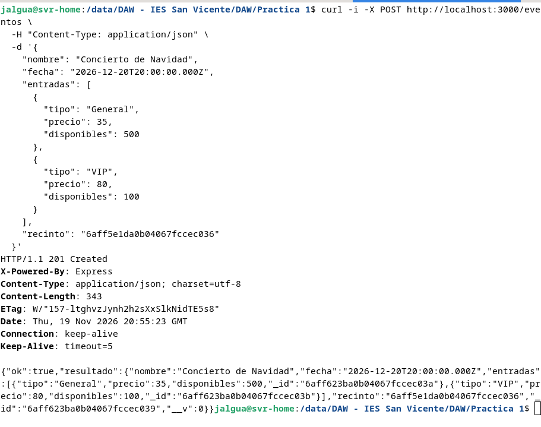

**Resultado:** prueba superada. La API registra correctamente el evento, sus tipos de entradas y la referencia al recinto existente, devolviendo HTTP 201 y la estructura JSON exigida.


### Prueba 13. GET /eventos — Consulta de eventos existentes

**Objetivo:** comprobar que la API recupera los eventos almacenados en MongoDB Atlas, incluyendo los datos completos del recinto asociado mediante `populate()` de Mongoose.

**Petición:**

```bash
curl -i http://localhost:3000/eventos
```

**Respuesta obtenida:**

- Código HTTP: `200 OK`.
- `ok: true`.
- `resultado`: array con el evento registrado.
- El campo `recinto` contiene un objeto con los datos del recinto asociado.

**Datos recuperados:**

| Campo | Valor |
|---|---|
| Evento | Concierto de Navidad |
| Fecha | 20/12/2026, 20:00 UTC |
| Entrada General | 35 € — 500 disponibles |
| Entrada VIP | 80 € — 100 disponibles |
| Recinto | Palacio de Congresos |
| Localidad | Sevilla |
| Aforo máximo | 1500 |

**Evidencia de la ejecución:**


**Resultado:** prueba superada. La API recupera correctamente los eventos y sus entradas. Se verifica que Mongoose resuelve la referencia al recinto mediante `populate()`, devolviendo sus datos completos en lugar de únicamente el identificador.


### Prueba 14. GET /eventos/:id — Consulta por identificador

**Objetivo:** comprobar que la API recupera un evento concreto mediante su identificador de MongoDB, incluyendo sus entradas y los datos del recinto asociado.

**Petición:**

```bash
curl -i http://localhost:3000/eventos/6aff623ba0b04067fccec039
```

**Respuesta obtenida:**

- Código HTTP: `200 OK`.
- `ok: true`.
- `resultado`: objeto con los datos del evento solicitado.

**Datos recuperados:**

| Campo | Valor |
|---|---|
| ID del evento | `6aff623ba0b04067fccec039` |
| Nombre | Concierto de Navidad |
| Fecha | 20/12/2026, 20:00 UTC |
| Entrada General | 35 € — 500 disponibles |
| Entrada VIP | 80 € — 100 disponibles |
| Recinto | Palacio de Congresos |
| Localidad | Sevilla |

**Evidencia de la ejecución:**

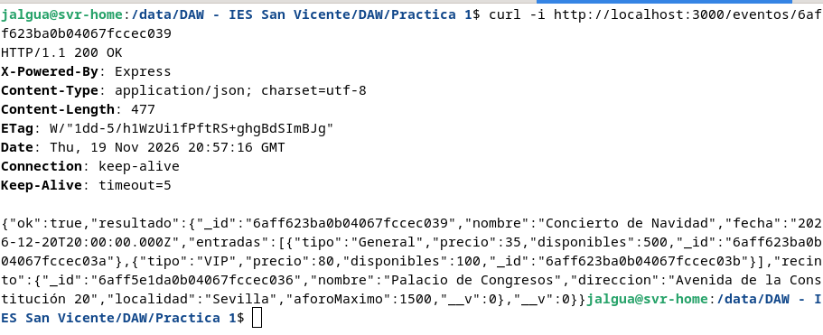

**Resultado:** prueba superada. La API recupera correctamente el evento solicitado mediante su identificador y devuelve sus entradas y los datos completos del recinto asociado, con HTTP 200 y la estructura JSON esperada.


### Prueba 15. GET /eventos/localidad/:nombre — Consulta de eventos futuros por localidad

**Objetivo:** comprobar que la API recupera los eventos futuros de una localidad determinada, incluyendo los datos del recinto asociado.

**Petición:**

```bash
curl -i http://localhost:3000/eventos/localidad/Sevilla
```

**Respuesta obtenida:**

- Código HTTP: `200 OK`.
- `ok: true`.
- `resultado`: array con los eventos futuros registrados en Sevilla.

**Datos recuperados:**

| Campo | Valor |
|---|---|
| Evento | Concierto de Navidad |
| Fecha | 20/12/2026, 20:00 UTC |
| Localidad | Sevilla |
| Recinto | Palacio de Congresos |
| Entrada General | 35 € — 500 disponibles |
| Entrada VIP | 80 € — 100 disponibles |

**Evidencia de la ejecución:**

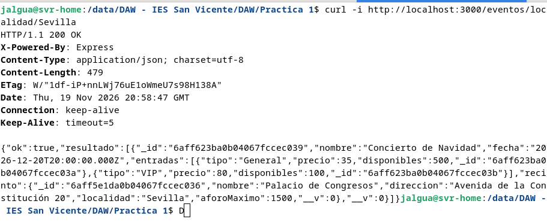

**Resultado:** prueba superada. La API filtra correctamente los eventos futuros por localidad y recupera los datos del recinto asociado mediante `populate()`, devolviendo HTTP 200 y la estructura JSON esperada.


### Prueba 16. GET /eventos/localidad/:nombre — Localidad sin eventos

**Objetivo:** comprobar que la API devuelve el error correspondiente cuando no existen eventos futuros en la localidad consultada.

**Petición:**

```bash
curl -i http://localhost:3000/eventos/localidad/Valencia
```

**Respuesta obtenida:**

- Código HTTP: `404 Not Found`.
- `ok: false`.

```json
{
  "ok": false,
  "error": "No se han encontrado eventos"
}
```

**Evidencia de la ejecución:**

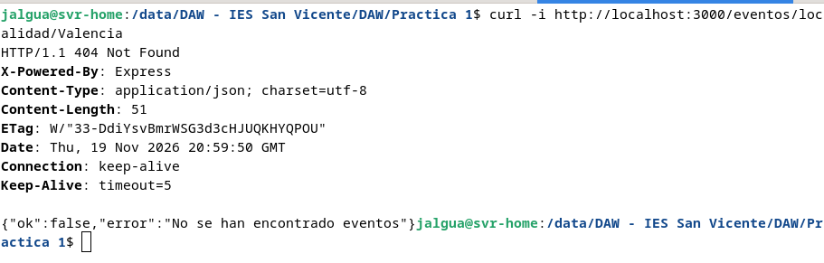

**Resultado:** prueba superada. La API devuelve el código HTTP 404 y el mensaje de error establecidos en el enunciado cuando no encuentra eventos futuros en la localidad solicitada.


### Prueba 17. GET /eventos/:id — Evento inexistente

**Objetivo:** comprobar que la API devuelve el error correspondiente cuando se consulta un evento que no existe en MongoDB Atlas.

**Petición:**

```bash
curl -i http://localhost:3000/eventos/000000000000000000000000
```

**Respuesta obtenida:**

- Código HTTP: `404 Not Found`.
- `ok: false`.

```json
{
  "ok": false,
  "error": "Evento 000000000000000000000000 no encontrado"
}
```

**Evidencia de la ejecución:**

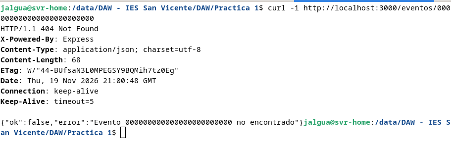

**Resultado:** prueba superada. La API identifica que el evento solicitado no existe y devuelve el código HTTP 404 y el mensaje de error establecidos en el enunciado.


### Prueba 18. PUT /eventos/:id — Actualización de evento existente

**Objetivo:** comprobar que la API permite modificar los datos de un evento registrado en MongoDB Atlas sin alterar los campos que no se incluyen en la petición.

**Petición:**

```bash
curl -i -X PUT http://localhost:3000/eventos/6aff623ba0b04067fccec039 \
  -H "Content-Type: application/json" \
  -d '{
    "nombre": "Gran Concierto de Navidad"
  }'
```

**Respuesta obtenida:**

- Código HTTP: `200 OK`.
- `ok: true`.
- `resultado`: objeto con el evento actualizado.

**Datos comprobados:**

| Campo | Resultado |
|---|---|
| Nombre anterior | Concierto de Navidad |
| Nombre actualizado | Gran Concierto de Navidad |
| Fecha | 20/12/2026, sin cambios |
| Entrada General | 35 € — 500 disponibles |
| Entrada VIP | 80 € — 100 disponibles |
| Recinto | Palacio de Congresos, sin cambios |

**Evidencia de la ejecución:**

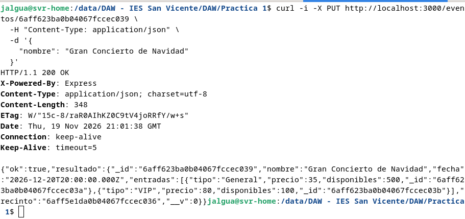

**Resultado:** prueba superada. La API actualiza correctamente el nombre del evento y conserva los demás campos, devolviendo HTTP 200 y la estructura JSON prevista.


### Prueba 19. PUT /eventos/:id — Actualización de evento inexistente

**Objetivo:** comprobar que la API devuelve el error correspondiente cuando se intenta actualizar un evento que no existe en MongoDB Atlas.

**Petición:**

```bash
curl -i -X PUT http://localhost:3000/eventos/000000000000000000000000 \
  -H "Content-Type: application/json" \
  -d '{
    "nombre": "Evento de Prueba"
  }'
```

**Respuesta obtenida:**

- Código HTTP: `404 Not Found`.
- `ok: false`.

```json
{
  "ok": false,
  "error": "Error actualizando evento 000000000000000000000000"
}
```

**Evidencia de la ejecución:**

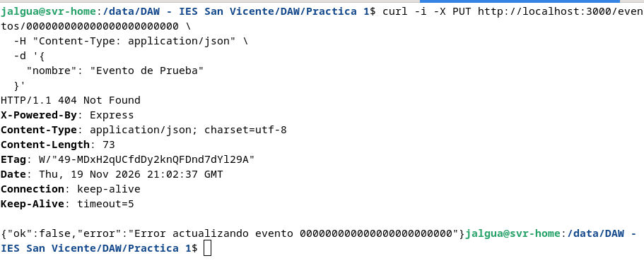

**Resultado:** prueba superada. La API devuelve HTTP 404 y el mensaje de error establecido en el enunciado cuando se intenta actualizar un evento inexistente.


### Prueba 20. GET /eventos/entradas/:idEvento/:tipoEntrada — Consulta de entradas

**Objetivo:** comprobar que la API permite consultar el precio y la cantidad disponible de un tipo de entrada de un evento determinado.

**Petición:**

```bash
curl -i http://localhost:3000/eventos/entradas/6aff623ba0b04067fccec039/General
```

**Respuesta obtenida:**

- Código HTTP: `200 OK`.
- `ok: true`.

```json
{
  "ok": true,
  "resultado": {
    "precio": 35,
    "disponibles": 500
  }
}
```

**Evidencia de la ejecución:**


**Resultado:** prueba superada. La API devuelve correctamente el precio y la disponibilidad de las entradas General del evento, con HTTP 200 y la estructura JSON establecida en el enunciado.


### Prueba 21. GET /eventos/entradas/:idEvento/:tipoEntrada — Tipo de entrada inexistente

**Objetivo:** comprobar que la API devuelve el error correspondiente cuando se consulta un tipo de entrada que no existe en el evento.

**Petición:**

```bash
curl -i http://localhost:3000/eventos/entradas/6aff623ba0b04067fccec039/Preferente
```

**Respuesta obtenida:**

- Código HTTP: `404 Not Found`.
- `ok: false`.

```json
{
  "ok": false,
  "error": "Error obteniendo datos de entrada para evento 6aff623ba0b04067fccec039"
}
```

**Evidencia de la ejecución:**

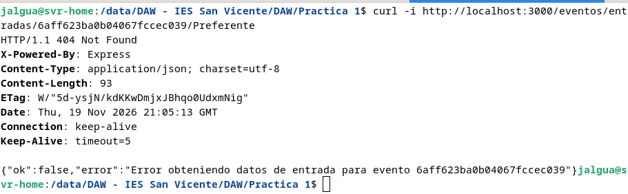

**Resultado:** prueba superada. La API identifica que el tipo de entrada Preferente no existe en el evento y devuelve HTTP 404 y el mensaje de error establecidos en el enunciado.


### Prueba 22. PUT /eventos/entradas/:idEvento/:tipoEntrada/:cantidad — Actualización de entradas

**Objetivo:** comprobar que la API descuenta correctamente las entradas disponibles de un evento al registrar una venta.

**Petición:**

```bash
curl -i -X PUT http://localhost:3000/eventos/entradas/6aff623ba0b04067fccec039/General/10
```

**Respuesta obtenida:**

- Código HTTP: `200 OK`.
- `ok: true`.
- `resultado`: objeto con el evento actualizado.

**Datos comprobados:**

| Campo | Antes | Después |
|---|---|---|
| Entradas General disponibles | 500 | 490 |
| Precio General | 35 € | 35 € |
| Entradas VIP disponibles | 100 | 100 |

**Evidencia de la ejecución:**

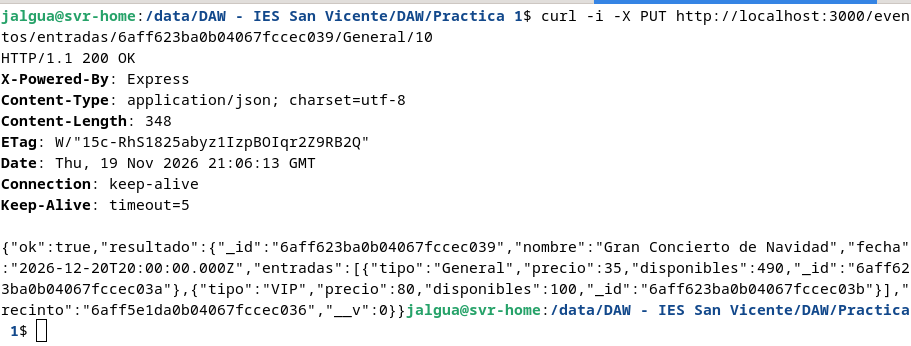

**Resultado:** prueba superada. La API descuenta correctamente las 10 entradas General solicitadas, conserva el precio y la disponibilidad de las entradas VIP y devuelve HTTP 200 con el evento actualizado.


### Prueba 23. PUT /eventos/entradas/:idEvento/:tipoEntrada/:cantidad — Entradas insuficientes

**Objetivo:** comprobar que la API impide vender una cantidad de entradas superior a las disponibles.

**Situación inicial:**

- Evento: Gran Concierto de Navidad.
- Tipo de entrada: General.
- Entradas disponibles: 490.
- Entradas solicitadas: 500.

**Petición:**

```bash
curl -i -X PUT http://localhost:3000/eventos/entradas/6aff623ba0b04067fccec039/General/500
```

**Respuesta obtenida:**

- Código HTTP: `404 Not Found`.
- `ok: false`.

```json
{
  "ok": false,
  "error": "Error actualizando entradas del evento 6aff623ba0b04067fccec039"
}
```

**Evidencia de la ejecución:**

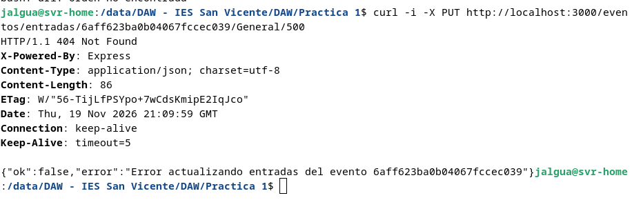

**Resultado:** prueba superada. La API rechaza la operación cuando la cantidad solicitada supera las entradas disponibles, devolviendo HTTP 404 y el mensaje de error previsto.


### Prueba 24. GET /eventos/entradas/:idEvento/:tipoEntrada — Verificación tras una venta rechazada

**Objetivo:** comprobar que las entradas disponibles no se modifican cuando se rechaza una venta por falta de disponibilidad.

**Situación previa:**

- Entradas General disponibles: 490.
- Venta solicitada: 500 entradas.
- Resultado de la operación anterior: HTTP 404.

**Petición:**

```bash
curl -i http://localhost:3000/eventos/entradas/6aff623ba0b04067fccec039/General
```

**Respuesta obtenida:**

- Código HTTP: `200 OK`.
- `ok: true`.

```json
{
  "ok": true,
  "resultado": {
    "precio": 35,
    "disponibles": 490
  }
}
```

**Evidencia de la ejecución:**

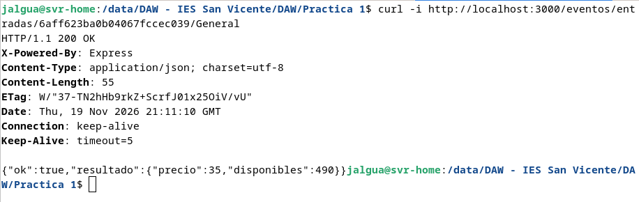

**Resultado:** prueba superada. Se confirma que la operación rechazada no modifica las entradas disponibles, que permanecen en 490.


### Prueba 25. DELETE /eventos/:id — Eliminación de evento inexistente

**Objetivo:** comprobar que la API devuelve el error correspondiente cuando se intenta eliminar un evento que no existe en MongoDB Atlas.

**Petición:**

```bash
curl -i -X DELETE http://localhost:3000/eventos/000000000000000000000000
```

**Respuesta obtenida:**

- Código HTTP: `404 Not Found`.
- `ok: false`.

```json
{
  "ok": false,
  "error": "Error eliminando evento 000000000000000000000000"
}
```

**Evidencia de la ejecución:**

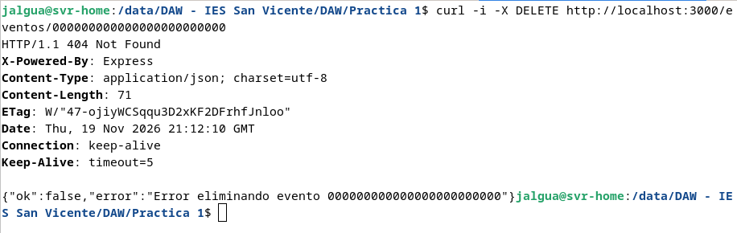

**Resultado:** prueba superada. La API devuelve HTTP 404 y el mensaje de error establecido en el enunciado cuando se intenta eliminar un evento inexistente. El evento existente permanece disponible.

