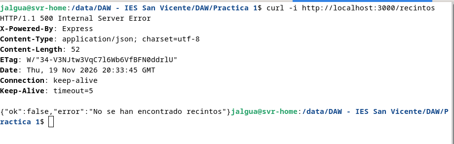
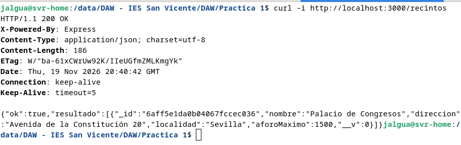

# Práctica 1 – Despliegue de Aplicaciones Web

## 1. Objetivo

Desarrollar y desplegar una API REST para gestionar eventos, recintos y entradas, utilizando Node.js, Express, Mongoose y MongoDB Atlas.

## 2. Tecnologías utilizadas

- Debian 12
- Node.js 24.22.2
- npm 11.19.1
- Express
- Mongoose
- MongoDB Atlas
- Nodemon
- Visual Studio Code
- Git y GitHub
- Render (despliegue)

## 3. Preparación del entorno

Se comprueba la instalación de las herramientas necesarias:

| Herramienta | Versión |
|---|---|
| Node.js | 24.22.2 |
| npm | 11.19.1 |
| Git | 2.39.5 |
| Visual Studio Code | 1.145.0 |

## 4. Estructura del proyecto

```text
Practica 1/
├── models/
│   ├── evento.js
│   └── recinto.js
├── routes/
│   ├── eventos.js
│   └── recintos.js
├── index.js
├── .env
├── .gitignore
├── package.json
└── package-lock.json
```

## 5. Dependencias

Se inicializa el proyecto Node.js y se instalan las dependencias:

- express: gestión del servidor y rutas REST.
- mongoose: conexión y gestión de modelos MongoDB.
- dotenv: lectura de variables de entorno.
- nodemon: reinicio automático del servidor durante el desarrollo.

## 6. Base de datos MongoDB Atlas

Se crea un clúster gratuito en MongoDB Atlas.

- Clúster: Cluster0
- Región: AWS, París (eu-west-3).
- Base de datos: eventos.

La conexión se configura mediante la variable MONGODB_URI en el fichero .env.

Las credenciales no se incluyen en el repositorio.

## 7. Implementación

Se crean los siguientes componentes:

- Modelo de eventos y subdocumentos de entradas.
- Modelo de recintos.
- Enrutador de eventos y entradas.
- Enrutador de recintos.
- Servidor principal Express.

## 8. Configuración del servidor

El servidor utiliza el puerto 3000 durante el desarrollo.

Se configura la conexión con MongoDB Atlas y el middleware para procesar peticiones JSON.

## 9. Comprobación inicial

Se ejecuta el servidor mediante:

```bash
npm run dev
```

Resultado obtenido:

- Conexión con MongoDB establecida correctamente.
- Servidor escuchando en el puerto 3000.

## 10. Pruebas y despliegue


### Prueba 1. GET /recintos — Colección vacía

**Objetivo:** comprobar la respuesta de la API cuando no existen recintos registrados.

**1. Arranque del servidor**

Se inicia la aplicación mediante:

```bash
npm run dev
```

Se comprueba que el servidor Express escucha en el puerto 3000 y que la conexión con MongoDB Atlas se establece correctamente.


**2. Petición HTTP**

```bash
curl -i http://localhost:3000/recintos
```

**3. Respuesta obtenida**

- Código HTTP: `500 Internal Server Error`.

```json
{
  "ok": false,
  "error": "No se han encontrado recintos"
}
```

**Evidencia de la ejecución:**



**4. Resultado**

**Prueba superada.** La API responde correctamente cuando la colección de recintos está vacía, devolviendo el código HTTP y el mensaje de error establecidos en el enunciado.


### Prueba 2. POST /recintos — Creación de recinto

**Objetivo:** comprobar la creación de un recinto en MongoDB Atlas.

**Petición:**

```bash
curl -i -X POST http://localhost:3000/recintos \
  -H "Content-Type: application/json" \
  -d '{
    "nombre": "Palacio de Congresos",
    "direccion": "Avenida de la Constitución 20",
    "localidad": "Sevilla",
    "aforoMaximo": 1500
  }'
```

**Resultado obtenido:**

- HTTP 201 Created.
- `ok: true`.
- Recinto creado correctamente con identificador `_id` generado por MongoDB.

**Conclusión:** prueba superada. El endpoint permite registrar recintos y devuelve la respuesta exigida.


### Prueba 3. GET /recintos — Consulta de recintos existentes

**Objetivo:** comprobar que la API recupera correctamente los recintos almacenados en MongoDB Atlas.

**Petición:**

```bash
curl -i http://localhost:3000/recintos
```

**Respuesta obtenida:**

- Código HTTP: `200 OK`.
- `ok: true`.
- `resultado`: array con el recinto registrado.

```json
{
  "ok": true,
  "resultado": [
    {
      "_id": "6aff5e1da0b04067fccec036",
      "nombre": "Palacio de Congresos",
      "direccion": "Avenida de la Constitución 20",
      "localidad": "Sevilla",
      "aforoMaximo": 1500,
      "__v": 0
    }
  ]
}
```

**Evidencia de la ejecución:**



**Resultado:** prueba superada. La API recupera los recintos registrados y devuelve el código HTTP y la estructura JSON establecidos en el enunciado.


### Prueba 4. GET /recintos/:id — Consulta por identificador

**Objetivo:** comprobar que la API recupera un recinto concreto mediante su identificador de MongoDB.

**Petición:**

```bash
curl -i http://localhost:3000/recintos/6aff5e1da0b04067fccec036
```

**Respuesta obtenida:**

- Código HTTP: `200 OK`.
- `ok: true`.
- `resultado`: objeto con los datos del recinto solicitado.

```json
{
  "ok": true,
  "resultado": {
    "_id": "6aff5e1da0b04067fccec036",
    "nombre": "Palacio de Congresos",
    "direccion": "Avenida de la Constitución 20",
    "localidad": "Sevilla",
    "aforoMaximo": 1500,
    "__v": 0
  }
}
```

**Evidencia de la ejecución:**


**Resultado:** prueba superada. La API localiza el recinto mediante su identificador y devuelve la respuesta HTTP y JSON esperada.


### Prueba 5. GET /recintos/localidad/:nombre — Consulta por localidad

**Objetivo:** comprobar que la API recupera los recintos registrados en una localidad determinada.

**Petición:**

```bash
curl -i http://localhost:3000/recintos/localidad/Sevilla
```

**Respuesta obtenida:**

- Código HTTP: `200 OK`.
- `ok: true`.
- `resultado`: array con los recintos de Sevilla.

```json
{
  "ok": true,
  "resultado": [
    {
      "_id": "6aff5e1da0b04067fccec036",
      "nombre": "Palacio de Congresos",
      "direccion": "Avenida de la Constitución 20",
      "localidad": "Sevilla",
      "aforoMaximo": 1500,
      "__v": 0
    }
  ]
}
```

**Evidencia de la ejecución:**


**Resultado:** prueba superada. La API filtra correctamente los recintos por localidad y devuelve la respuesta exigida en el enunciado.


### Prueba 6. GET /recintos/:id — Recinto inexistente

**Objetivo:** comprobar que la API devuelve el error correspondiente cuando se consulta un recinto que no existe en MongoDB Atlas.

**Petición:**

```bash
curl -i http://localhost:3000/recintos/000000000000000000000000
```

**Respuesta obtenida:**

- Código HTTP: `404 Not Found`.
- `ok: false`.

```json
{
  "ok": false,
  "error": "Recinto 000000000000000000000000 no encontrado"
}
```

**Evidencia de la ejecución:**


**Resultado:** prueba superada. La API identifica que el recinto solicitado no existe y devuelve el código HTTP 404 y el mensaje de error establecidos en el enunciado.


### Prueba 7. GET /recintos/localidad/:nombre — Localidad sin recintos

**Objetivo:** comprobar que la API devuelve el error correspondiente cuando no existen recintos registrados en la localidad solicitada.

**Petición:**

```bash
curl -i http://localhost:3000/recintos/localidad/Valencia
```

**Respuesta obtenida:**

- Código HTTP: `404 Not Found`.
- `ok: false`.

```json
{
  "ok": false,
  "error": "No se han encontrado recintos de la localidad indicada"
}
```

**Evidencia de la ejecución:**


**Resultado:** prueba superada. La API devuelve el código HTTP 404 y el mensaje de error establecidos en el enunciado cuando no existen recintos en la localidad consultada.


